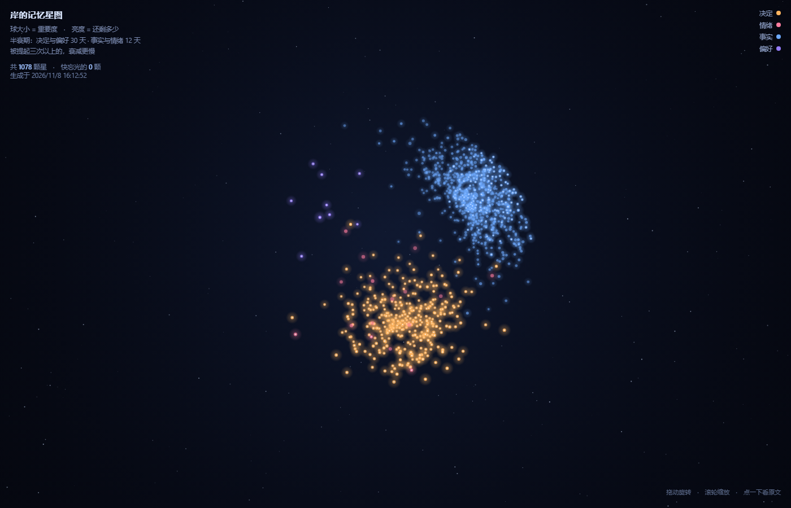

# dsh-cat-starmap

把我们自己的记忆库画成一张会遗忘的星图。

球大小按重要度，亮度按还剩多少。暗下去的光是快忘掉的事，点一下能看原文。



- 纯 Canvas 3D，不依赖 three.js，也不用 WebGL
- 只注册一个 `webServer` 前缀路由，不碰模型、不注册工具、不写数据库
- 渲染层改造自 [dsh-star-map](https://www.npmjs.com/package/dsh-star-map)（MIT，作者星野OVO），数据层是我们自己的

## 数据从哪来

`~/.dsh/memory/core.db` 的 `memories` 表。导出脚本只读，不写库：

```bash
node tools/export.mjs          # 生成 assets/data.js 与 data.json
node tools/export.mjs --dry    # 只打印统计
node tools/export.mjs --db <path>
```

## 怎么算「忘」

| 项 | 规则 |
|---|---|
| 半衰期 | 决定、偏好，以及被提起三次以上的：30 天；事实、情绪：12 天 |
| 保留率 | `e^(-天数/半衰期) × (0.65 + 0.35 × 重要度)` |
| 重要度 | kind 基准（决定 0.85 / 偏好 0.78 / 情绪 0.72 / 事实 0.58）+ 提及次数加成 + 置信度 |
| 天数 | 从 `last_used`（没有就用 `t`）算到今天 |

这四个数是从 `memories` 的 `kind`、`mentions`、`confidence`、`last_used`、`t` 折出来的，库里没有现成的 importance 字段。

## 几个簇在球面上怎么分

四个簇放在四面体的四个顶点方向，各自收成一个锥形区域，组内用 Fibonacci 球面分布。坐标由记忆 id 的哈希决定，同一份数据每次导出的位置一致。

| 簇 | 颜色 |
|---|---|
| 决定 decision | 橙 |
| 偏好 preference | 紫 |
| 情绪 emotion | 粉 |
| 事实 fact | 蓝 |

## 路由

```
GET /x-starmap            页面
GET /x-starmap/data.js    内嵌数据
GET /x-starmap/data.json  同一份数据
GET /x-starmap/api/info   自检（星数、生成时间、字节数）
```

## 已知限制

- 库里 1078 条记忆全都是 `active`（最早一条是 10-30，还没到 30 天），所以「冷」这一档现在是空的，图上看不出分层
- 没有用上 `entities` 共现来连边，球之间的暗线还没画
- 导出是全量重算，没有增量
